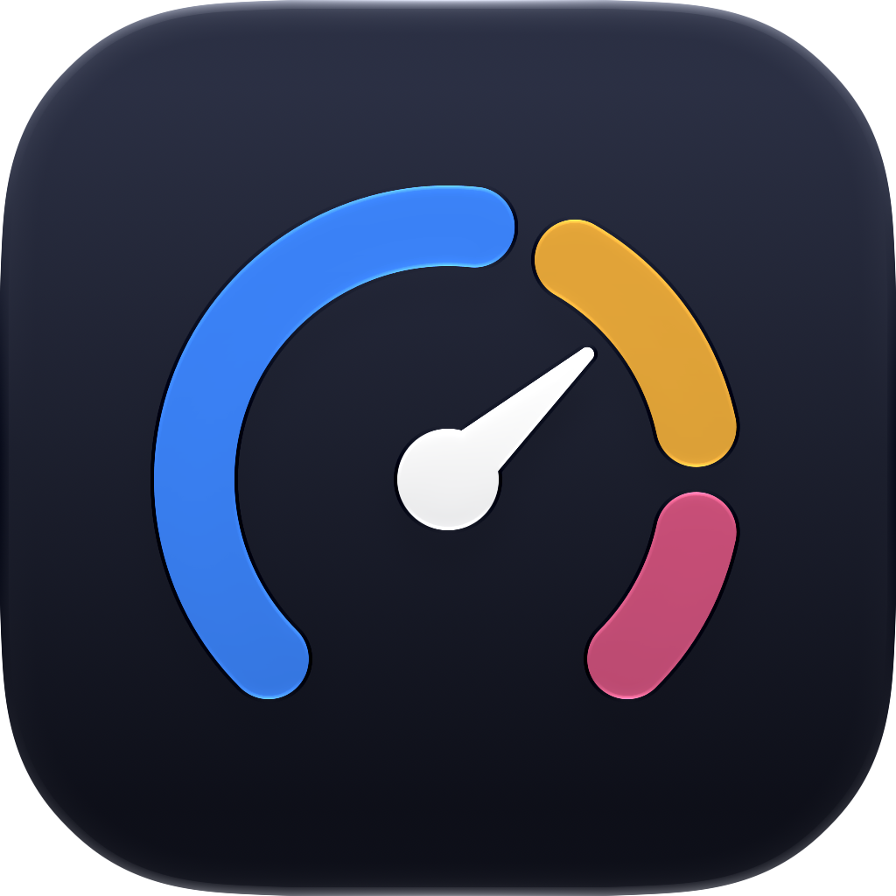

<p align="center">
  
</p>

<h1 align="center">Barometry</h1>

<p align="center">
  Live system stats in your Mac's menu bar, with a detailed dashboard a click away.
</p>

Barometry shows CPU, GPU, memory, network, sensor, and battery readings as compact menu bar graphs and gauges. Click any of them to open a dashboard with per-core load, temperatures, power, clocks, and disk usage.

## Features

- Menu bar modules for CPU, GPU, memory, network, sensors, and battery
- One menu bar item per module, or a single combined item in the order you choose
- A dashboard in two styles, an instrument cluster of dials or a list of rows with live trends, with sections you can hide
- Details beside the dashboard: hover a section to see its history and breakdown, or click it to keep them open
- Temperatures in °C or °F, and a choice of network interface
- A refresh interval of 1, 2, or 5 seconds, with 1-second updates while the dashboard is open
- Launch at login
- Under 1% CPU while idle

## Install

Barometry requires an Apple silicon Mac running macOS 26 or later.

There are no releases yet. [Build from source](#build-from-source) to try it.

### Getting started

Barometry lives in the menu bar and has no Dock icon. Click a menu bar item to open the dashboard, and hover or click a section to see its details. Choose **Settings…** (⌘,) to pick modules, the layout, and the refresh interval. Quit from the dashboard or with ⌘Q.

In the individual layout, hold ⌘ and drag menu bar items to rearrange them.

## Build from source

Install Xcode 27 and [XcodeGen](https://github.com/yonaskolb/XcodeGen), then run:

```sh
brew install xcodegen
git clone https://github.com/WolffTech/barometry.git
cd barometry
xcodegen generate
open Barometry.xcodeproj
```

The Xcode project is generated from `project.yml` and isn't checked in. Regenerate it after pulling or after adding, removing, or renaming files.

To build from the command line:

```sh
xcodebuild -project Barometry.xcodeproj -scheme Barometry -configuration Release -derivedDataPath build build
open build/Build/Products/Release/Barometry.app
```

Logic lives in the `BarometryKit` package and is tested with Swift Testing. Run the tests with ⌘U in Xcode, or:

```sh
swift test --package-path Packages/BarometryKit
```
